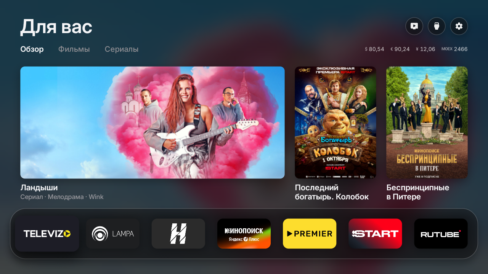

<div align="center">


# vladOS

**Быстрый главный экран без рекламы для Google TV и Android TV — адаптированный для России.**

Подборки фильмов из Кинопоиска, погода, курсы ЦБ и МосБиржа, светлая тема днём и тёмная ночью.<br>
Форк [Free My TV](https://github.com/simbasjungles/free-my-tv). Открытый код. Возврат к заводскому экрану — одной кнопкой.



</div>

## Зачем этот форк

Free My TV — отличный главный экран, но в России половина его источников не открывается без VPN: TMDB (подборки) заблокирован, Open-Meteo (погода) не отвечает, а онлайн-кинотеатры в нём только зарубежные. vladOS заменяет всё это на то, что работает из российских сетей:

| | Free My TV | vladOS |
|---|---|---|
| Подборки фильмов | TMDB | **Кинопоиск** через [poiskkino.dev](https://poiskkino.dev) |
| Онлайн-кинотеатры | Netflix, Prime Video, Disney+… | **Кинопоиск, Okko, Wink, PREMIER, START, Амедиатека** |
| Узкие карточки | середина широкого кадра | **вертикальный постер**, длинные названия в две строки |
| Погода | Open-Meteo | **MET Norway** (api.met.no), запасной — wttr.in |
| Котировки | криптовалюты (Binance) | **курсы ЦБ** и **МосБиржа** |

VPN не нужен.

## Что умеет

- **Без рекламы.** Никаких спонсорских рядов, баннеров и автозапуска промо.
- **Ваши приложения на виду.** Онлайн-кинотеатры, которыми вы пользуетесь, на стеклянной полке. Состав и порядок выбираются прямо на телевизоре.
- **Подборки, а не реклама.** Три новых фильма или сериала каждый час: самое популярное на Кинопоиске за последние год-два, и только то, что есть в приложениях на вашем телевизоре. Кнопка «Смотреть» открывает нужный кинотеатр. Отдельные вкладки «Фильмы» и «Сериалы».
- **Погода и рынок под рукой.** Прогноз по часам, восход и закат; курсы доллара, евро и юаня от ЦБ, индекс МосБиржи и акции — Сбербанк, Газпром, Лукойл, Яндекс. Четыре позиции на выбор.
- **Днём светлый, ночью тёмный.** Тема переключается по настоящему закату в вашем городе.
- **Заставка в тон.** Полноэкранные кадры из подборок и большие часы.
- **Быстрый.** 60 кадров в секунду на собственном процессоре телевизора.
- **Настраивается на телевизоре.** Язык, город, единицы температуры, тема, виджеты погоды и котировок, приложения на полке — в настройках vladOS.
- **Безопасный.** Без root. Ничего не удаляется. Одна кнопка возвращает заводской главный экран.

## Установка

Около десяти минут. Нужен телевизор или приставка на Google TV / Android TV (Android 8 и новее) и компьютер в той же Wi-Fi-сети.

### Проще всего: через AI-ассистента

1. **На телевизоре** включите режим разработчика: Настройки → Система → Об устройстве → 7 раз нажмите на *Сборка ОС Android TV*. Затем Настройки → Система → Для разработчиков → включите **Отладку по USB**. Запишите IP-адрес телевизора (Настройки → Сеть и Интернет).
2. **Получите бесплатный ключ Кинопоиска** — см. [ниже](#ключ-кинопоиска).
3. **На компьютере** откройте AI-ассистента для кода ([Claude Code](https://claude.com/claude-code), Codex или Antigravity) и скажите:
   > Установи vladOS (github.com/axeds933/vladOS) на мой телевизор 192.168.1.50. Я живу в Москве.

   Подставьте IP своего телевизора и свой город. Ассистент скачает код, поставит нужные инструменты, соберёт приложение и установит его, спрашивая перед важными шагами. Ключ Кинопоиска вставьте в `config.properties` сами, когда он попросит.
4. **На телевизоре** откройте *vladOS* → *Главный экран* → *vladOS*. Телевизор спросит *Разрешить отладку по USB?* — отметьте *Всегда разрешать* и подтвердите.

### Вручную

1. **На телевизоре** сделайте шаг 1 из списка выше.
2. **Инструменты:** JDK 17+, Android SDK command-line tools (build-tools 34 или новее, platform android-34) и adb.
   - **Windows:** поставьте [Git for Windows](https://git-scm.com/download/win) (сборка идёт в Git Bash), [Temurin JDK 17](https://adoptium.net) и [Android command-line tools](https://developer.android.com/studio#command-line-tools-only), затем:
     ```bash
     sdkmanager "platform-tools" "build-tools;34.0.0" "platforms;android-34"
     ```
   - **macOS:**
     ```bash
     brew install --cask temurin android-commandlinetools android-platform-tools
     sdkmanager "build-tools;34.0.0" "platforms;android-34"
     ```
   - **Linux:** OpenJDK 17, command-line tools и adb из пакетного менеджера, затем та же команда `sdkmanager`.
3. **Сборка:**
   ```bash
   ./build.sh
   ```
   Первый запуск создаёт `config.properties`. Впишите туда ключ Кинопоиска и свой город (см. [Настройки](#настройки)) и запустите сборку ещё раз.

   > **Windows:** в Git Bash указывайте пути к SDK и JDK в виде `C:/…`, а не `/c/…` — иначе javac не найдёт нужные библиотеки:
   > ```bash
   > ANDROID_HOME='C:/Users/<вы>/Android/Sdk' JAVA_HOME='C:/Program Files/Eclipse Adoptium/jdk-17…' ./build.sh
   > ```
4. **Установка:**
   ```bash
   adb connect 192.168.1.50:5555
   adb install -r FreeMyTV.apk
   ```
   На телевизорах TCL дополнительно разрешите работу в фоне (по умолчанию TCL её блокирует, и переключение не запустится):
   ```bash
   adb shell "appops set io.freemytv AUTO_START allow || appops set io.freemytv APP_AUTO_START allow"
   ```
5. **На телевизоре** откройте *vladOS* → *Главный экран* → *vladOS*. Телевизор ещё раз спросит *Разрешить отладку по USB?*, теперь для самого vladOS: отметьте *Всегда разрешать* и подтвердите.

Уже стоит Free My TV? vladOS ставится поверх него: внутреннее имя пакета то же (`io.freemytv`). Но подписан он будет вашим ключом, так что если оригинал собирали не вы — сначала удалите его.

## Настройки

Начальные значения берутся из `config.properties`, который создаёт первая сборка. Большинство из них можно поменять и на телевизоре, в *vladOS* → *Главный экран*, — выбор на телевизоре главнее.

| Параметр | Что делает | По умолчанию |
|---|---|---|
| `kinopoisk_key` | Ключ [poiskkino.dev](https://poiskkino.dev) — подборки из Кинопоиска | пусто |
| `latitude`, `longitude` | Координаты города: погода, восход и закат | Нью-Йорк |
| `city` | Название на карточке погоды | «Погода» |
| `temperature` | `C`, `F` или `auto` | `auto` |
| `language` | `auto` (как на телевизоре) или код языка (`ru`, `en`, `uk`…) | `auto` |
| `show_crypto` | Показывать котировки (курсы и МосБиржу) на главном экране и заставке | `true` |
| `hide_animation` | Не показывать мультфильмы и аниме в подборках | `false` |
| `hide_services` | Кинотеатры, которых не должно быть в подборках, даже если приложение стоит (`kinopoisk`, `okko`, `wink`, `premier`, `start`, `amediateka`), через запятую | пусто |
| `disable_assistant` | Заодно отключить Google Ассистента | `false` |
| `tmdb_key`, `tmdb_region` | Подборки из TMDB, как в оригинале. Работают, только если `kinopoisk_key` пуст; из России TMDB без VPN недоступен | пусто, `US` |

Пример для Москвы:

```properties
kinopoisk_key=ваш-ключ
latitude=55.7558
longitude=37.6173
city=Москва
temperature=C
```

Поменяли что-то? Запустите `./build.sh` и установите заново. **Сохраните `freemytv.keystore`:** обновления подписываются им, без него новую версию не поставить поверх старой.

### Котировки

Вверху главного экрана и в карточке «Курсы» — четыре позиции. Что в них показывать, выбирается в *vladOS* → *Главный экран* → *Позиция 1–4*: OK или ▶ листают вперёд, ◀ — назад. На выбор: доллар, евро, юань, индекс МосБиржи, Сбербанк, Газпром, Лукойл, Яндекс или «Выкл».

- **Валюты** — официальный курс ЦБ (через [cbr-xml-daily.ru](https://www.cbr-xml-daily.ru)), обновляется раз в день, изменение — к предыдущему курсу.
- **Индекс и акции** — с [Московской биржи](https://iss.moex.com) (ISS, без ключа), с задержкой около 15 минут, изменение — за день.

### Ключ Кинопоиска

Бесплатный, выдаётся за минуту: напишите Telegram-боту [@poiskkinodev_bot](https://t.me/poiskkinodev_bot) и вставьте полученный ключ после `kinopoisk_key=`. Бесплатного тарифа (200 запросов в день) хватает с запасом: vladOS обновляет список раз в 6 часов двумя запросами. Ключ ваш — `config.properties` не попадает в git.

## Как вернуть всё обратно

На телевизоре: *vladOS* → *Главный экран* → *Заводской*. Заводской главный экран, заставка и все приложения вернутся ровно такими, какими были. Если новый главный экран упадёт три раза за пять минут, он сам переключится обратно.

Чтобы удалить совсем, сначала выберите *Заводской*, потом удалите *vladOS* (Настройки → Приложения). Удалили, пока он был включён? Установите снова и выберите *Заводской*: список того, что он отключал, хранится в настройках телевизора, так что всё вернётся.

## Что меняется на телевизоре

- vladOS становится главным экраном и заставкой.
- Отключаются (не удаляются):
  - заводской главный экран и заставка;
  - резервный главный экран Google TV, Play Игры и YouTube Music;
  - на TCL — TCL Channel, сообщения, демо-режим, гостиничное меню, инструкции, трансляция экрана и сбор логов;
  - на телевизорах KTC (NextStar), Philco, Multilaser — промо-каналы, распознавание содержимого экрана (ACR), демо-режим и инструкции;
  - Google Ассистент — только при `disable_assistant=true`.
- На TCL, Vestel, KTC, Sony и проекторах Xiaomi (Formovie) кнопки приложений на пульте продолжают работать; что каждая открывает, выбирается в *vladOS* → *Кнопки пульта*.
- Изображение, звук, входы, пульт, сервисы Google и Play Маркет — в защищённом списке, который проверяется перед каждым изменением. Перед отключением чего-либо телевизор спрашивают, не зависят ли от этого его входы и кнопка Input.
- Приложения, сохранившие сеть Wi-Fi, никогда не отключаются: Android удалил бы эту сеть. Если первая настройка телевизора сохранила вашу сеть, переключение попросит сначала забыть её и подключиться заново в настройках.

## Другие телевизоры

vladOS работает на Google TV и Android TV: TCL, Sony, Hisense, Philips, Xiaomi, Haier, телевизоры Vestel (F&U) и KTC (NextStar), приставки Chromecast с Google TV, Google TV Streamer, onn 4K, NVIDIA Shield и другие. Проверен на Haier Android TV (Android 11).

**Любой другой телевизор:** подключите приставку на Google TV по HDMI и поставьте vladOS на неё.

**LG и Samsung.** В оригинале есть версии для LG (webOS) и Samsung (Tizen) — папки [`web/`](web), [`webos/`](webos), [`tizen/`](tizen). **В vladOS они не адаптированы:** там по-прежнему TMDB, Open-Meteo и Binance, так что в России без VPN подборки и погода работать не будут. Инструкции по установке — в [README оригинала](https://github.com/simbasjungles/free-my-tv#lg-tvs-webos).

**Другая марка или модель:** код рассчитан на доработку с помощью AI. Откройте папку в Claude Code и скажите *«настрой под мой телевизор»* — он изучит телевизор, найдёт его главный экран и промо-приложения и обновит списки. Как это делать, описано в [CLAUDE.md](CLAUDE.md).

| Что | Где |
|---|---|
| Приложения, которые отключаются | `DEBLOAT` в [`HomeMode.java`](app/src/io/freemytv/HomeMode.java) |
| Приложения, которые нельзя трогать | `PROTECTED` там же |
| Приложения на полке | `SHELF` в [`HomeApps.java`](app/src/io/freemytv/HomeApps.java) |
| Приложение эфирного ТВ вашей марки | `LIVE_TV_APPS` там же |
| Онлайн-кинотеатры для подборок | `SERVICES` в [`Recs.java`](app/src/io/freemytv/Recs.java) |
| Позиции котировок | `COINS` в [`HomeData.java`](app/src/io/freemytv/HomeData.java) |

## Как это устроено

- **Обычное Android-приложение без Gradle и библиотек.** [`build.sh`](build.sh) запускает aapt2 → javac → d8 → zipalign → apksigner и собирает APK размером около 1–2 МБ.
- **Использует ADB самого телевизора изнутри.** Приложение подключается к `127.0.0.1:5555` своим ключом (отсюда вопрос *Разрешить отладку по USB?*) и выполняет те же команды, что и вы бы: `cmd package set-home-activity`, `settings put secure screensaver_components`, `pm disable-user`. Ничего не слушает сеть.
- **Всё нарисовано вручную на одном Canvas**, с шейдерами Android 13 для матового стекла (на Android 8–12 — простые заливки).
- **Страховка.** Сторожевой процесс возвращает заводской главный экран после трёх падений за пять минут, а проверка при загрузке сохраняет ваш выбор после обновлений телевизора.
- **Данные:** Кинопоиск через poiskkino.dev (фильмы, сериалы, постеры и в каком кинотеатре что идёт), MET Norway (погода; восход и закат рассчитываются по координатам), ЦБ РФ через cbr-xml-daily.ru (курсы валют), Московская биржа (индекс и акции).

| Файл | Что это |
|---|---|
| [`HomeView.java`](app/src/io/freemytv/HomeView.java) | Главный экран |
| [`HomeMode.java`](app/src/io/freemytv/HomeMode.java) | Переключение между vladOS и заводским экраном |
| [`Adb.java`](app/src/io/freemytv/Adb.java) | ADB телевизора изнутри |
| [`Recs.java`](app/src/io/freemytv/Recs.java) | Подборки (Кинопоиск, TMDB) |
| [`HomeData.java`](app/src/io/freemytv/HomeData.java) | Погода и котировки |
| [`Backdrop.java`](app/src/io/freemytv/Backdrop.java) | Картинки карточек и фона |
| [`HomeApps.java`](app/src/io/freemytv/HomeApps.java) | Полка, входы и все приложения |
| [`DreamView.java`](app/src/io/freemytv/DreamView.java) | Заставка |
| [`SettingsActivity.java`](app/src/io/freemytv/SettingsActivity.java) | Экран настроек (иконка приложения) |
| [`Prefs.java`](app/src/io/freemytv/Prefs.java) | Настройки, изменённые на телевизоре |
| [`Watchdog.java`](app/src/io/freemytv/Watchdog.java) | Страховка |

## Переводы

Каждый язык — один файл [`app/assets/i18n/<язык>.json`](app/assets/i18n), ключи — английский текст из кода. *Автоматически* выбирает язык телевизора. Русский перевод сделан вручную. Новые надписи vladOS (названия котировок, «Позиция 1–4», «Курсы») пока только на русском.

Инструменты для переводов — `tools/translate.py`, см. [README оригинала](https://github.com/simbasjungles/free-my-tv#translations).

## Приватность

Никаких аккаунтов, аналитики и слежки. Приложение обращается только к poiskkino.dev (с вашим ключом), к картинкам Кинопоиска, к api.met.no (с координатами из настроек; wttr.in — если met.no не ответил), к cbr-xml-daily.ru и iss.moex.com. Настройки остаются на вашем компьютере и телевизоре.

## Благодарности

- Оригинал — [Free My TV](https://github.com/simbasjungles/free-my-tv) от [@simbasjungles](https://github.com/simbasjungles). vladOS — его форк, адаптированный для России.
- Сделано с помощью [Claude Code](https://claude.com/claude-code).
- Данные о фильмах — [Кинопоиск](https://www.kinopoisk.ru) через неофициальный API [poiskkino.dev](https://poiskkino.dev).
- Погода — [MET Norway](https://api.met.no) (CC BY 4.0) и [wttr.in](https://wttr.in).
- Курсы валют — Банк России через [cbr-xml-daily.ru](https://www.cbr-xml-daily.ru). Индекс и акции — [Московская биржа](https://www.moex.com) (ISS).
- Иконки — [Material Symbols](https://fonts.google.com/icons) (Apache 2.0). Шрифт — [Inter](https://rsms.me/inter/) (SIL OFL 1.1).
- Проект не связан с Google, Кинопоиском, Московской биржей, Банком России, производителями телевизоров и онлайн-кинотеатрами. Названия и логотипы принадлежат их владельцам.

## Лицензия

[MIT](LICENSE), как у оригинала. Форкайте, меняйте, пользуйтесь.
